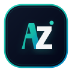

<div align="center">
  

  # Alaa Zayood — Personal Portfolio
  **Senior Full Stack Developer · Odoo ERP Specialist & Systems Analyst · MSc Web Science**

  [](https://nextjs.org/)
  [](https://react.dev/)
  [](https://www.typescriptlang.org/)
  [](https://tailwindcss.com/)
  [](https://www.odoo.com/)
</div>

---

## ✨ Overview

A modern, high-performance, bilingual (**English LTR** & **Arabic RTL**) developer portfolio designed and built to showcase enterprise ERP architectures, Odoo implementations, full-stack web applications, cross-platform Flutter mobile apps, and desktop software.

### Key Highlights
- 🌐 **Full Bilingual Support (EN / AR):** Seamless switching between English (`LTR`) and Arabic (`RTL`) via custom React Context.
- 🌓 **Adaptive Dark & High-Contrast Light Mode:** Persistent theme switching (`localStorage`) with custom glassmorphic surfaces and accessible typography.
- 🎬 **Interactive Project Showcase:** Embedded YouTube product demos, live Vercel deployments, and architectural breakdowns.
- ⚡ **Modern Tech Stack:** Powered by **Next.js 16 (App Router)**, **React 19**, **Tailwind CSS v4**, and **Framer Motion**.
- 📄 **Direct CV Download:** One-click resume download (`Alaa-Zayood-CV.pdf`).

---

## 🚀 Featured Projects

| Project | Category | Tech Stack | Links |
| :--- | :--- | :--- | :--- |
| **Viatica ERP** | ★ Featured Enterprise ERP & Mobile Ecosystem | Node.js, Express, MongoDB, React, TypeScript, Flutter | [Live Demo](https://viatica-enterprise.vercel.app/) · [Video Demo](https://youtu.be/5O5SCzk0-lo) · [Source](https://github.com/alaaazayoud-debug/viaitica-project) |
| **Menu App** | Interactive Restaurant Digital Menu | React, Vite, Tailwind CSS | [Live Demo](https://menu-app-three-ecru.vercel.app/) · [Source](https://github.com/alaaazayoud-debug/menu-app) |
| **Daratia Website** | Corporate Electronics Company Portal | React, Tailwind CSS, Vercel | [Live Demo](https://daratia.vercel.app/) · [Source](https://github.com/alaaazayoud-debug/daratia-website) |
| **Bike Shop Manager** | Desktop Inventory, Sales & Invoicing ERP | Python, PyQt5, SQLite | [Video Demo](https://youtu.be/n5d-QqQrZGw) · [Source](https://github.com/alaaazayoud-debug/bike_shop_manager) |
| **Sanad Mobile App** | Cross-Platform Mobile Application | Flutter, Dart, Appwrite BaaS | [Source](https://github.com/alaaazayoud-debug/sanad-mobile-app) |
| **Ezar Group Website** | Corporate Business Platform | Web, Frontend, Responsive UI | [Source](https://github.com/alaaazayoud-debug/ezar_group_website) |

---

## 🛠️ Core Technical Stack

- **ERP & Systems Analysis:** Odoo ERP (Implementation, Customization, Workflow Automation), Systems Analysis & Modeling
- **Frontend:** Next.js, React, TypeScript, Tailwind CSS, Framer Motion
- **Backend & Databases:** Node.js, Express.js, Python, PostgreSQL, MongoDB, SQLite, Firebase, Appwrite
- **Mobile & Desktop:** Flutter, Dart, Dio, PyQt5
- **DevOps & Tools:** Git, Docker, Vercel, RESTful APIs, JWT Auth

---

## 💻 Running Locally

```bash
# 1. Install dependencies
npm install

# 2. Run the development server
npm run dev

# 3. Build for production
npm run build
npm start
```

Open [http://localhost:3000](http://localhost:3000) in your browser.

---

## 📬 Contact & Links

- **Email:** [alaazayood@gmail.com](mailto:alaazayood@gmail.com)
- **LinkedIn:** [Alaa Zayood](https://www.linkedin.com/in/alaa-zayood-b41316352)
- **GitHub:** [@alaaazayoud-debug](https://github.com/alaaazayoud-debug)
- **WhatsApp:** [+963 966 262 458](https://wa.me/963966262458)

---

<div align="center">
  Designed & Built by <strong>Alaa Zayood</strong>
</div>
